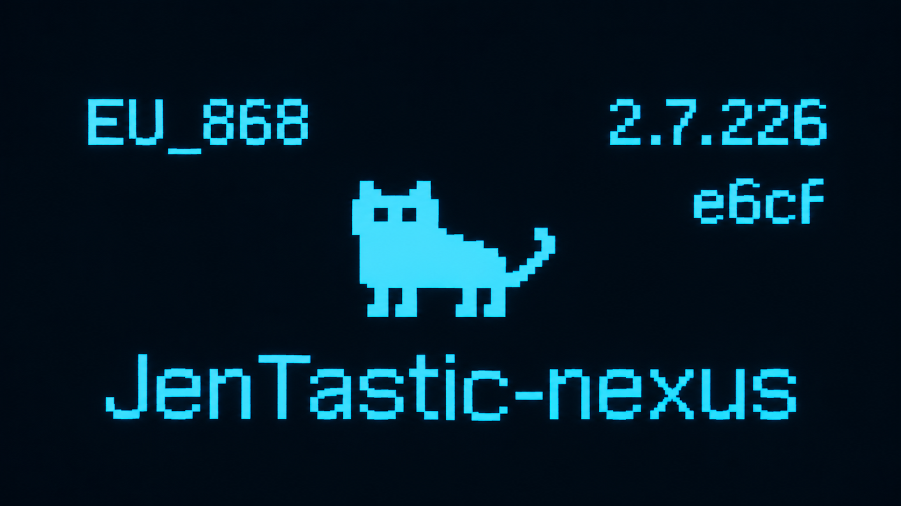

<div align="center" markdown="1">

# Jentastic / Nexus Firmware

**A custom firmware based on the Meshtastic® firmware, for infrastructure and personal nodes alike.**

[](docs/why-the-license.md)
[](LICENSE)
[](https://meshtastic.org)
[](#building--flashing)

[](https://meshtastic.es)

<br/>



<br/>
<br/>

*A friendly soft fork born during the rollouts of the [Spanish Meshtastic Community](https://meshtastic.es) mesh • made with human-curated, human-reviewed agentic engineering.*

</div>

---

> [!NOTE]
> *Meshtastic® is a registered trademark of Meshtastic LLC. This project is an independent community initiative and is not affiliated with, sponsored by, or endorsed by Meshtastic LLC.*

---

## Main Features

A summary of the highlights — check [docs/nexus-commands.md](docs/nexus-commands.md) for the full 100+ command reference:

| Category | Highlights & Capabilities |
|---|---|
| **Remote CLI Admin** | Full remote command administration over LoRa through an admin channel (`/nexus` / `/jt`). Perform real-world tasks upstream remote admin can't do: send messages or traceroutes *from* remote mountain nodes, inspect live RSSI / SNR / Frequency Error, force safe reboots, and manage nodes over multi-hop links with broadcast, direct, group, or MAC-suffix addressing. |
| **Stateless Firewall** | Granular inbound and outbound packet filtering (`DROP` / `OUTDROP`) across 40+ port and category tags (NodeInfo, Position, Telemetry subsets, TraceRoutes, Admin, etc.) to handle rogue or spammy nodes without dropping them entirely. Includes an 8-slot arbitrary binary signature firewall (`FSIG`) and private channel whitelists/blacklists. As well as rate limits for each packet type |
| **Configurable Zero-Hop (ZH)** | Upstream Meshtastic supports zero-hop routing by marking nodes as favorites in the NodeDB. Jentastic can replace this system with a dedicated, highly configurable 256-bit relay bitmask (`zero_hop_mask`). Manage zero-hop nodes directly (`ZH ADD`/`DEL`), export/import base64 masks, auto-populate from heard traffic (`ZH ROUTER ON`, `ZH CLIENT ON`), and selectively preserve position (`ZH POS ON`) or telemetry (`ZH TELE ON`) so only messages and so on travel the mesh zero hop. |
| **Signal Intelligence (SIGINT)** | Tactical RF tools: live spectrum sweeps (`FREQSCAN`), high-resolution noise floor snapshots (`NOISE`), signal history ring buffer (`RSSILOG`), public ping bot (`PPING`) with customizable headers and emoji modes, node reach surveys (`NETSCAN`),  repeater mapping (`CLIENTSCAN`), as well as statistics tracking for specifically monitored nodes (`WATCH`). |
| **Modem & RF Presets** | Command based LoRa settings (`SETLORA`), expanded preset library (`PRESET`) supporting standard Sub-GHz, community narrow presets (`SFNarrow`, `NarrowPlus`, `NarrowProMax`), Mini-1..8, and 2.4 GHz Spanish presets (`Madrid24`, `Medium24`). Includes hardware band-safety guards, **multi-SF concurrent listening on LR2021**, and **experimental FSK/GFSK (`SETFSK`) and FLRC (`SETFLRC`) modulations.** |
| **Automation, Cron & Macros** | Built-in 8-slot cron scheduler (`CRON`) supporting periodic intervals, daily scheduled times, or one-shot executions, plus a 4-slot macro runner (`MACRO`) for automated multi-command routines. |
| **Persistent Storage Vault** | Dedicated binary storage vault (`/nexus.bin`) holding all the Nexus settings without altering the upstream config protobufs. Inspect and diff saved states anytime with `VAULT` and `VAULT DIFF`. |
| **Routing Enhancements** | `CLIENT_BASE` rebroadcast timing (repeating on the normal `CLIENT` window rather than the delayed `LATE` window) (User configurable), and **`CLIENTALWAYS`** for non-router infraestructure nodes, as well as **`BASETEXTS`** overrides for rooftop repeaters. |

---

## Documentation

| Document | Purpose |
|---|---|
| [**nexus-commands.md**](docs/nexus-commands.md) | Full command reference for all 100+ `/nexus` CLI commands on public builds. |
| [**manual.md**](docs/manual.md) | The Nexus channel, master keys, and how to compile your own firmware with them. |
| [**why-the-license.md**](docs/why-the-license.md) | Detailed explanation of why AGPLv3 is used for the Nexus module. |

---


## Building & Flashing

Builds the exact same way as the official Meshtastic firmware using [PlatformIO](https://platformio.org):

```bash
# Clone the repository
git clone https://github.com/derpyspike/jentastic.git
cd jentastic

# Build for your target board (e.g. Heltec v3, Seeed Xiao S3, RAK4631...)
pio run -e seeed-xiao-s3

# Flash to device
pio run -e seeed-xiao-s3 -t upload
```
---

> [!TIP]
> For a keyed or personal build, you can also use `build-nexus.sh`, a helper script that injects builder defaults and master keys if you wanna use them — see [docs/manual.md](docs/manual.md).

---

## The Name

This firmware was originally called the **Nexus firmware**, named in honor of one of the infrastructure nodes it was first designed for. During field deployments, the community came up with the quite fitting nickname of **Jentastic**, and it stuck! That's why it proudly carries both names.

---

## Why Does This Exist?

This firmware was born around a year ago during the deployments and testing of infrastructure nodes in the Spanish Meshtastic™ mesh ([meshtastic.es](https://meshtastic.es)), currently one of the largest meshes in the world. This involved many preset tests, including the custom SFNarrow preset we use today.

During these tests and field deployments, we noticed a few real world shortcomings of the upstream firmware:

* **Remote admin in 2.7 doesn't let you send messages from a node** (for understandable reasons), or send a traceroute *from* a remote node.
  * Also notably, you can't see RSSI or Frequency Error on traceroutes. Frequency Error is normally only available over local serial; on high mountain nodes, that's impossible to check without climbing up there!
* **Changing LoRa settings across a multi-hop network is fragile.** When trying different LoRa settings, you have to update a whole chain of nodes you administer. Over standard remote admin, this often fails over multiple hops — especially if you're transitioning through a preset with poor link budget. A compact CLI command can and does reach more reliably.
* **Accidental lockout recovery.** If for any reason TX is disabled on a node, standard remote admin won't let you re-enable it over LoRa anymore. Disabling TX remotely is also sometimes useful, for example for battery saving on cloudy days.
* **Scaling pains in large meshes.** A mesh network doesn't get to grow large without misconfigured or runaway nodes spamming and bringing the channel utilization to 100%. The only upstream solution is usually adding them to ignores, which is a "throw the baby out with the bathwater" approach. With upstream firmware, you don't get confirmation of whether it worked, you can't easily inspect the ignore list, and if a node wasn't in your NodeDB (almost guaranteed in a 2000+ node network), the ignore command would simply fail.
* **Targeted favorites & zero-hop repeaters.** Managing favorites on infrastructure nodes is essential for zero-hop routers and dedicated admin nodes, and doing that reliably over the air needed a first-class CLI.

For these reasons, the CLI has become insanely useful: you can track signals, send messages from a router so others can gauge their downlink when the router doesn't hear their uplink, throttle misbehaving traffic, or manage dozens of remote nodes with speed and confidence.

---
## Extra included board variants
* Promicro DIY SX1262: same as the upstream nrf52_promicro_diy_tcxo variant, but smaller binary size for SX1262 only builds
* Promicro DIY SX1262-noscreen: Same but without screen support for even smaller builds
* Promicro DIY E28: For 2.4GHz nodes using Ebyte E28s and similar nodes, adds a TXEN pin, and is SX128X exclusive. (Can be used with the Faketech 2.4GHz and Albatastic series PCBs for example)
* xiaowa-esp32c3: for @gargomoma's Xiaowa PCB with ESP32-C3
* Cutretech-S3: @skgsergio's xiao-s3 + E22P build, can also be used with some Albatastic series PCBs.

---

## What This Isn't

This isn't a hard fork, and it isn't meant to be one. It is designed to be **completely interchangeable** with either the upstream official firmware or other custom firmwares, and never break compatibility on-air with either the mesh, standard channels, or phone client apps.
